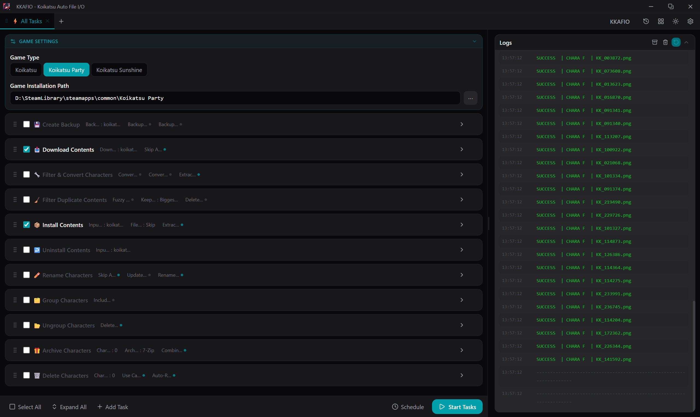

# KKAFIO: Koikatsu Auto File I/O

All-in-one utility for Koikatsu / Koikatsu Party / Koikatsu Sunshine: download, install, sort and archive cards, scenes, outfits and mods.

📖 **Documentation: <https://reddeaddepresso.github.io/KKAFIO/>**

## Requirements

- 7-Zip installed.
- If running from source: [uv](https://docs.astral.sh/uv/getting-started/installation/) installed.

## Quick start

Download the latest release, extract it, and run `KKAFIO.exe`. Configure the settings to your preference and press **Start**.

To run from source:

1. Clone or download this repository.
2. Run `uv sync` in the repository folder.
3. Run `uv run tools/download_gui.py` to download the GUI.
4. Open `KKAFIO.exe`, configure your settings and press **Start**.

See [Installation](https://reddeaddepresso.github.io/KKAFIO/getting-started/installation/) for the optional setup utilities in `kkafio_setup.bat`.

## What it does

| | |
|---|---|
| [Create Backup](https://reddeaddepresso.github.io/KKAFIO/tasks/create-backup/) | [Download Contents](https://reddeaddepresso.github.io/KKAFIO/tasks/download-contents/) |
| [Filter & Convert KKS Cards](https://reddeaddepresso.github.io/KKAFIO/tasks/filter-convert-kks-cards/) | [Filter Duplicate Contents](https://reddeaddepresso.github.io/KKAFIO/tasks/filter-duplicate-contents/) |
| [Download Missing Mods](https://reddeaddepresso.github.io/KKAFIO/tasks/download-missing-mods/) | [Compress Card Textures](https://reddeaddepresso.github.io/KKAFIO/tasks/compress-card-textures/) |
| [Install Contents](https://reddeaddepresso.github.io/KKAFIO/tasks/install-contents/) | [Uninstall Contents](https://reddeaddepresso.github.io/KKAFIO/tasks/uninstall-contents/) |
| [Group Characters](https://reddeaddepresso.github.io/KKAFIO/tasks/group-characters/) | [Ungroup Cards](https://reddeaddepresso.github.io/KKAFIO/tasks/ungroup-cards/) |
| [Rename Characters](https://reddeaddepresso.github.io/KKAFIO/tasks/rename-characters/) | [Archive Cards](https://reddeaddepresso.github.io/KKAFIO/tasks/archive-cards/) |
| [Delete Cards](https://reddeaddepresso.github.io/KKAFIO/tasks/delete-cards/) | [Export Mods](https://reddeaddepresso.github.io/KKAFIO/tasks/export-mods/) |
| [Delete Unused Mods](https://reddeaddepresso.github.io/KKAFIO/tasks/delete-unused-mods/) | [Group Scenes](https://reddeaddepresso.github.io/KKAFIO/tasks/group-scenes/) |
| [Review Similar Characters](https://reddeaddepresso.github.io/KKAFIO/tasks/review-similar-characters/) | [Organize Library](https://reddeaddepresso.github.io/KKAFIO/tasks/organize-library/) |

New to KKAFIO? The [presets](https://reddeaddepresso.github.io/KKAFIO/presets/) bundle tasks into one-click workflows, such as the full download-to-install pipeline.

## Documentation

- [Getting started](https://reddeaddepresso.github.io/KKAFIO/getting-started/installation/): [game type](https://reddeaddepresso.github.io/KKAFIO/getting-started/game-type/), [context menu](https://reddeaddepresso.github.io/KKAFIO/getting-started/context-menu/), [languages](https://reddeaddepresso.github.io/KKAFIO/getting-started/languages/)
- [Tasks](https://reddeaddepresso.github.io/KKAFIO/tasks/): every task and option
- [Presets](https://reddeaddepresso.github.io/KKAFIO/presets/)
- [CLI usage](https://reddeaddepresso.github.io/KKAFIO/cli/)
- [Developer guide](https://reddeaddepresso.github.io/KKAFIO/developer/)
- [Known issues](https://reddeaddepresso.github.io/KKAFIO/known-issues/) and [changelog](CHANGELOG.md)

To preview the docs locally: `uvx zensical serve`.

## Acknowledgements

See [Acknowledgements](https://reddeaddepresso.github.io/KKAFIO/acknowledgements/).

## License

[AGPL-3.0](LICENSE)
