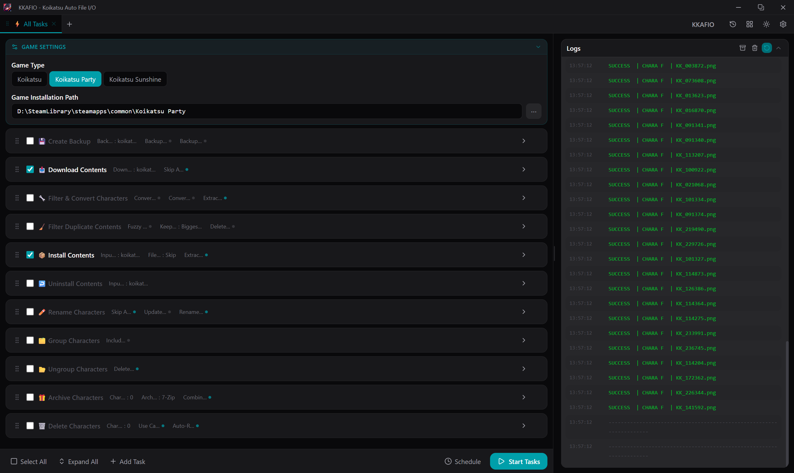

---
hide:
  - navigation
  - toc
---

# KKAFIO: Koikatsu Auto File I/O

All-in-one utility for **Koikatsu / Koikatsu Party / Koikatsu Sunshine**: download, install, sort and archive cards, scenes, outfits and mods.

-   :lucide-rocket: **[Getting started](getting-started/installation.md)**

    Requirements, installation, and first run.

-   :lucide-list-checks: **[Tasks](tasks/index.md)**

    What every task does and every option it has.

-   :lucide-layers: **[Presets](presets.md)**

    One-click workflows, such as the full download-to-install pipeline.

-   :lucide-mouse-pointer-click: **[Context menu](getting-started/context-menu.md)**

    Run tasks straight from the Windows Explorer right-click menu.

-   :lucide-terminal: **[CLI usage](cli.md)**

    Every task is also a `kkafio_cli` subcommand.

-   :lucide-code: **[Developer guide](developer/index.md)**

    How KKAFIO is put together, for anyone modifying it.

